  

 

### 📊 Aktywność zespołu

  

  Liczone codziennie z aktywności całego zespołu, w repozytoriach publicznych i prywatnych.

### 🧭 Jak pracujemy

  

  Jeden zespół od pierwszej rozmowy do wydania: bez pośredników, z jasnym zakresem i regularnymi wersjami do sprawdzenia.

### 🛠️ Technologie

<table border="0" width="100%">
  <tr>
    <td align="center" width="33%" valign="top">
      
<b>⚡ Web i UI</b>

      
    </td>
    <td align="center" width="33%" valign="top">
      
<b>🖥️ Desktop i backend</b>

      
    </td>
    <td align="center" width="33%" valign="top">
      
<b>☁️ Chmura i narzędzia</b>

      
    </td>
  </tr>
</table>

 

> [!NOTE]
> **Dlaczego publicznych repozytoriów jest tu niewiele?**
> Większość naszej pracy to projekty dla klientów, więc ich kod zostaje prywatny, a statystyki powyżej obejmują też tę pracę. 🔒 Chętnie pokażemy przykłady realizacji w rozmowie.

### 🤝 Porozmawiajmy

  

  <b>Masz pomysł na aplikację, narzędzie dla firmy albo produkt do wydania?</b> 
  Zaprojektujemy, zbudujemy i wdrożymy go na webie i desktopie, a potem zadbamy o kolejne wersje. 
  ⚡ <i>Konkretnie · Szybko · Dopracowane w każdym pikselu</i>

  &nbsp;&nbsp;
  &nbsp;&nbsp;
  

